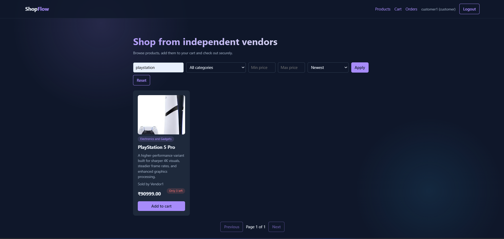
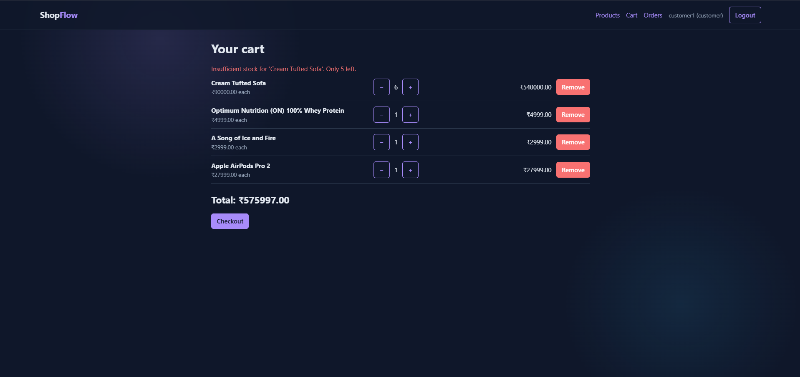

# ShopFlow

A full stack multi-vendor e-commerce app. Customers browse and buy, vendors manage their own products, and checkout is concurrency-safe, so the last item can't be oversold.

## Live demo
- **App:** https://shopflow-frontend-alpha.vercel.app
- **API docs (Swagger):** https://shopflow-backend-5o0j.onrender.com/api/docs/
- **Demo customer:** `customer1` / `Customer123`
- **Demo vendor:** `vendor1` / `Vendor123`

*Free hosting: the first load can take up to a minute while the server wakes up.*

## Repositories
- Frontend (this repo): React + Vite
- Backend: https://github.com/mohanrajtunes/shopflow-backend (Django REST Framework)

## Features
- JWT login with automatic token refresh
- Role-based UI and API permissions: customer, vendor, admin
- Product search, category and price filters, sorting and pagination
- Cart with quantity updates
- Atomic checkout with row-level locking and stock validation
- Order history
- Vendor dashboard: create, edit, delete products, with image upload to Cloudinary

## Tech stack
**Frontend:** React, React Router, Axios, Vite, Cloudinary
**Backend:** Django, Django REST Framework, SimpleJWT, PostgreSQL (Neon)
**Hosting:** Vercel (frontend), Render (API)

## Screenshots

### Product catalog


### Search and filters


### Cart


### Concurrency-safe stock check


### Order history


### Vendor dashboard


## Run locally
1. Start the [backend](https://github.com/mohanrajtunes/shopflow-backend).
2. `npm install`
3. Create a `.env.local` file in the project root:

   ```
   VITE_API_URL=http://127.0.0.1:8000
   VITE_CLOUDINARY_CLOUD_NAME=your_cloud_name
   VITE_CLOUDINARY_UPLOAD_PRESET=your_unsigned_preset
   ```

4. `npm run dev`