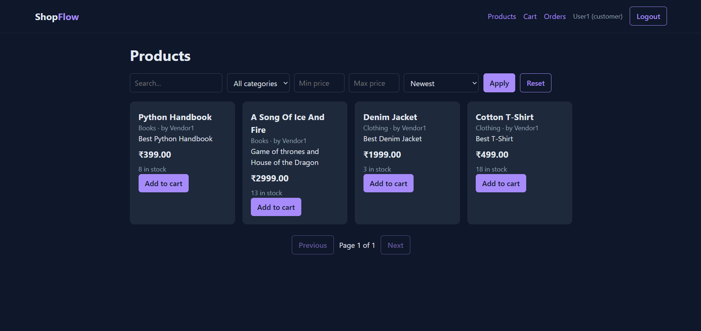
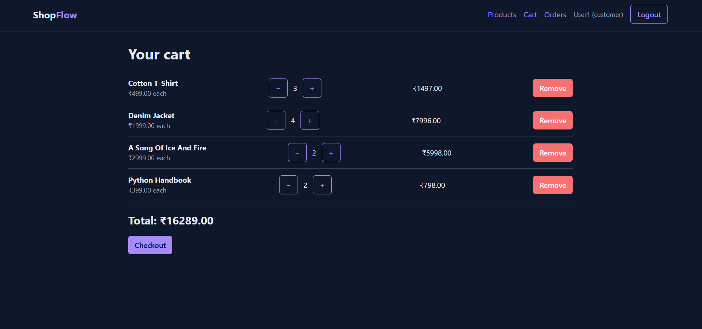
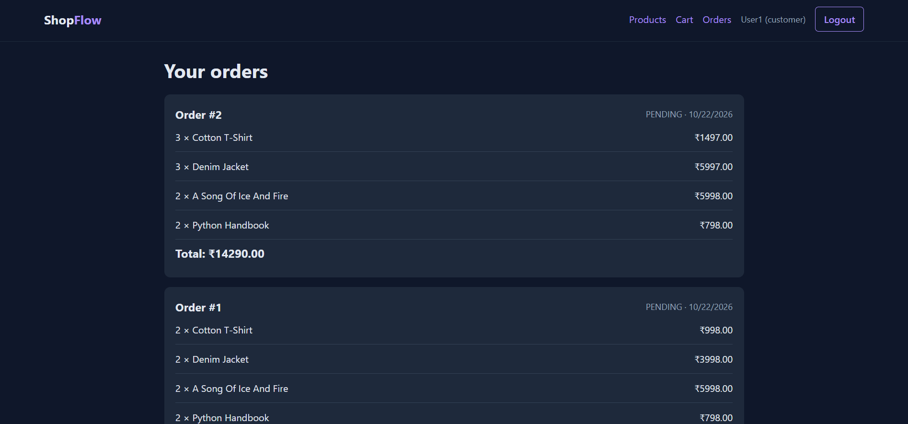

# ShopFlow Frontend

React frontend for [ShopFlow](https://github.com/mohanrajtunes/shopflow-backend), a multi-vendor e-commerce platform with role-based access and concurrency-safe checkout.

## Features
- JWT login with automatic token refresh
- Role-based UI: customers shop, vendors manage their own products
- Product search, category and price filters, sorting and pagination
- Cart with quantity updates and atomic checkout
- Order history
- Vendor dashboard: create, edit and delete products

## Tech Stack
React, React Router, Axios, Vite

## Screenshots

## Run locally
1. Start the [backend](https://github.com/mohanrajtunes/shopflow-backend)
2. `npm install`
3. Create `.env.local` with `VITE_API_URL=http://127.0.0.1:8000`
4. `npm run dev`